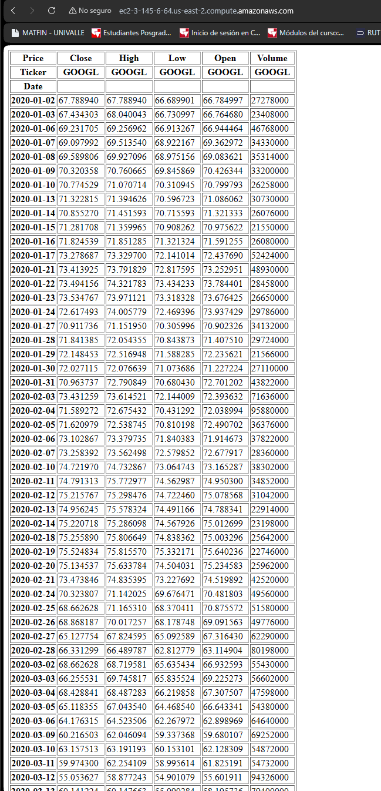

# Taller 01 – Despliegue de Servicios de Red

Servicio web en Python (Flask + yfinance) que muestra el histórico de la acción **GOOGL** desde 2020-01-01. Está empaquetado como imagen Docker, publicado en Docker Hub y desplegado en una máquina virtual AWS EC2.

- **Imagen Docker Hub:** [`cadrojasl/stock-market:2.0`](https://hub.docker.com/r/cadrojasl/stock-market)

## Estructura

| Carpeta / archivo | Contenido |
|---|---|
| `v1-script/` | Script por consola (`stock-market:1.0`). Ticker configurable con `-e STOCK=AMZN` |
| `v2-flask/` | Servicio web con Flask en el puerto 5000 (`stock-market:2.0`) |
| `setup_vm.sh` | Instala Docker en la VM Ubuntu de EC2 y ejecuta el contenedor |
| `GUIA.md` | Guía paso a paso del taller |
| `captura_aws.png` | Evidencia del servicio funcionando en AWS |

## Uso local

```bash
docker image build -t stock-market:2.0 v2-flask
docker container run --rm -p 5000:5000 stock-market:2.0
# http://localhost:5000
```

## Despliegue en EC2 (Ubuntu x86, HTTP habilitado)

```bash
curl -fsSL https://get.docker.com | sudo sh
sudo usermod -aG docker ubuntu
sudo docker run -d --name stock-market -p 80:5000 cadrojasl/stock-market:2.0
# http://<Public IPv4 DNS>
```

El puerto 80 de la VM (abierto en el Security Group) se redirige al 5000 donde escucha Flask.


